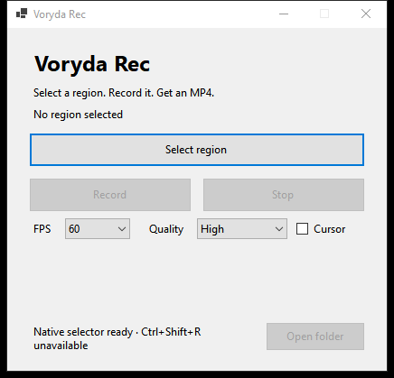

  <picture>
    <source media="(prefers-color-scheme: dark)" srcset="https://raw.githubusercontent.com/smouj/voryda-rec/main/assets/logo-dark.png?v=aa63e884a62d9e65f176825624dddf01a7e14ccf63a600452fbc89640b3cfee6">
    <source media="(prefers-color-scheme: light)" srcset="https://raw.githubusercontent.com/smouj/voryda-rec/main/assets/logo.png?v=aa63e884a62d9e65f176825624dddf01a7e14ccf63a600452fbc89640b3cfee6">
    
  </picture>

<h1 align="center">Voryda Rec</h1>

  <strong>Capture a region of your desktop and save it as an MP4.</strong>

  
  
  
  
  
  

  <a href="#overview">Overview</a> ·
  <a href="#features">Features</a> ·
  <a href="#project-status">Status</a> ·
  <a href="#build-from-source">Build</a> ·
  <a href="#privacy">Privacy</a>

## Overview

**Voryda Rec** is a native Windows screen recorder for capturing a selected desktop region and writing a standard H.264 MP4 file. The application is built with C# and .NET 8 using Windows Forms.

The capture pipeline uses Windows Graphics Capture as its primary backend, with DXGI Desktop Duplication as a fallback. Direct3D 11 processes frames, and Windows Media Foundation encodes the video. The current app has no microphone or system-audio controls and does not use FFmpeg.

## Features

- Select a desktop region and start or stop recording from the app.
- Toggle recording with <kbd>Ctrl</kbd>+<kbd>Shift</kbd>+<kbd>R</kbd>.
- Choose 30 or 60 frames per second and a video quality preset.
- Include or hide the cursor.
- Save the result as an H.264 MP4 file and validate it before reporting success.
- Keep recording settings locally between sessions.

## Project status

Voryda Rec is in **alpha**. The end-to-end recording path has been exercised locally, but mixed-DPI, multi-monitor, device-removal and broader hardware coverage are not complete. The repository does not currently have a public GitHub Release.

The latest recorded verification matrix is dated **2026-09-20**. See the [verification record](docs/history/verification-2026-09-20.md) for the tested scenarios and their limits.

## Screenshot

*The screenshot shows the current Windows application.*

## Requirements

- Windows 10 version 2004 (build 19041) or Windows 11, x64.
- Direct3D 11-capable graphics hardware.
- Windows Media Foundation.
- The .NET 8 SDK to build from source. A framework-dependent build also needs the .NET 8 Desktop Runtime.

## Build from source

    git clone https://github.com/smouj/voryda-rec
    cd voryda-rec
    dotnet restore AreaRec.sln --runtime win-x64
    dotnet build AreaRec.sln --configuration Release --no-restore
    dotnet run --project src\AreaRec.App\AreaRec.App.csproj

Create the portable package with the repository script:

    .\PUBLISH_PORTABLE.ps1

The solution, capture backends, Media Foundation layer and Windows UI smokes are documented in the [development guides](docs/README.md). The CI workflow is [native-ci.yml](.github/workflows/native-ci.yml).

## Local data and privacy

Voryda Rec makes no network requests in its current supported runtime. It has no account system, telemetry or upload path. Recordings are saved to the destination selected in the app; preferences are stored under <code>%LOCALAPPDATA%\AreaRec</code>.

See [the privacy notes](docs/user/privacy.md) for details.

## License

Voryda Rec is distributed under the [MIT License](LICENSE). Third-party dependencies are listed in [THIRD_PARTY.md](THIRD_PARTY.md).

---

  <strong>Voryda</strong> 
  Focused Windows utilities.

  <a href="https://github.com/smouj/voryda-snap">Snap</a> ·
  <a href="https://github.com/smouj/voryda-rec">Rec</a> ·
  <a href="https://github.com/smouj/voryda-down">Down</a> ·
  <a href="https://github.com/smouj/voryda-cut">Cut</a>

