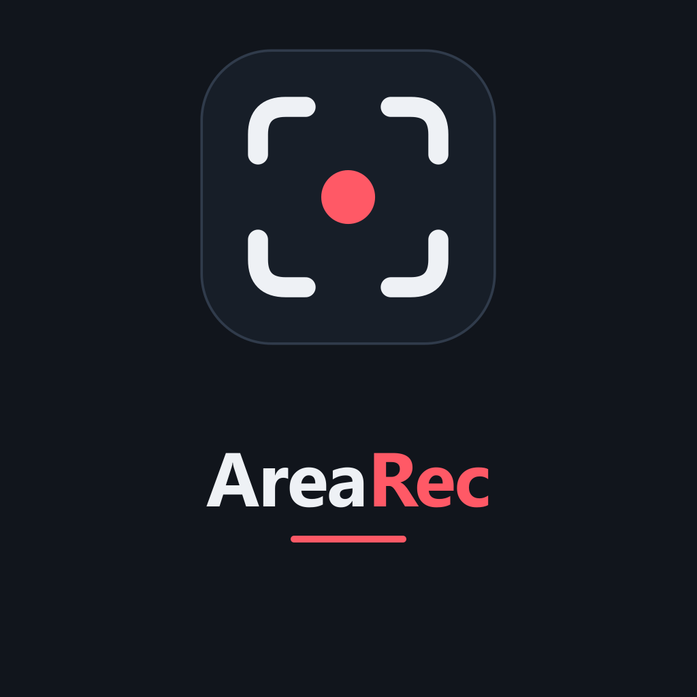

<p align="center">
  <picture>
    <source media="(prefers-color-scheme: dark)" srcset="assets/logo-dark.png">
    <source media="(prefers-color-scheme: light)" srcset="assets/logo.png">
    
  </picture>
</p>

<h1 align="center">Voryda Rec</h1>

<p align="center">
  <strong>Select a region. Record it. Get an MP4.</strong>
</p>

<p align="center">
  
  
  
  
  
  
</p>

<p align="center">
  <a href="#overview">Overview</a> ·
  <a href="#current-status">Status</a> ·
  <a href="#recording-pipeline">Pipeline</a> ·
  <a href="#build">Build</a> ·
  <a href="#documentation">Docs</a> ·
  <a href="#privacy">Privacy</a>
</p>

## Overview

**Voryda Rec** is a local Windows region recorder focused on one job: select an exact area of the desktop, record it, stop, and keep a standard MP4 file.

The supported runtime is native .NET 8. Windows Graphics Capture is the primary capture backend, DXGI Desktop Duplication is available as a fallback, Direct3D 11 handles frame processing, and Media Foundation writes H.264/MP4 output. The application does not depend on Python, FFmpeg, Electron or a remote service.

Voryda Rec is currently **alpha**. The recording path has been exercised end to end on the development machine, but the full cross-hardware, mixed-DPI and multi-monitor matrix has not been completed.

## Current status

There is currently **no GitHub Release** published for this repository. A self-contained Windows x64 package has been produced and validated locally; that is not the same as a public release.

The latest recorded native verification matrix is dated **2026-09-20**.

| Area | State | Verified evidence |
| --- | --- | --- |
| Region selection and <kbd>Ctrl</kbd>+<kbd>Shift</kbd>+<kbd>R</kbd> | **Verified locally** | UI smoke covers the shortcut, selector, Escape and drag selection. |
| Windows Graphics Capture | **Verified locally** | Runtime smoke produced desktop frames. |
| DXGI Desktop Duplication | **Verified locally** | Runtime and playback smokes produced and decoded frames at 30 and 60 FPS. |
| Direct3D 11 crop/readback and pacing | **Verified locally** | Exercised in the WGC-to-MP4 end-to-end path. |
| H.264 / MP4 at 30 FPS | **Verified locally** | Encoded and decoded on the development host. |
| H.264 / MP4 at 60 FPS | **Verified locally** | Encoded and decoded on the development host. |
| Cursor on/off | **Verified locally** | Saved outputs showed decoded-frame differences between the two settings. |
| Post-save validation | **Verified locally** | Final MP4 is inspected before success is reported. |
| Safe file finalization | **Verified locally** | Temporary-file path, zero-frame rejection and abort cleanup are covered. |
| Self-contained x64 package | **Verified locally** | Portable payload, checksum, icon and packaged UI smoke were validated. |
| System-audio engine | **Verified internally** | WASAPI loopback and A/V mux tests pass locally; it is not exposed in the current product UI. |
| Mixed-DPI / multi-monitor visual accuracy | **Not fully verified** | Coordinate tests exist, but two-monitor visual acceptance is still required. |
| Device removal / display hot-plug / suspend-resume | **Not verified on faulting hardware** | Error paths exist; the hardware scenarios remain outstanding. |
| Full 1080p/1440p/4K hardware matrix | **Not complete** | The complete requested hardware/DPI/monitor matrix has not been run. |
| Public release | **Not published** | GitHub Releases is currently empty. |

Full evidence and the limits of each result are kept in [docs/history/verification-2026-09-20.md](docs/history/verification-2026-09-20.md).

## Recording workflow

1. Start Voryda Rec.
2. Choose the recording settings.
3. Select the desktop region to record.
4. Start and stop with the application controls or <kbd>Ctrl</kbd>+<kbd>Shift</kbd>+<kbd>R</kbd>.
5. The recording is finalized to MP4.
6. The saved file is re-inspected before the application reports success.

The current product surface supports **30 or 60 FPS** and **cursor on/off**. Settings are persisted locally between sessions.

## Recording pipeline

```text
Desktop
  │
  ├─ Windows Graphics Capture
  │        or
  └─ DXGI Desktop Duplication
           │
           ▼
      Direct3D 11
   crop / scale / readback
           │
           ▼
     bounded frame flow
           │
           ▼
    Media Foundation
      H.264 / MP4
           │
           ▼
   temporary output file
           │
           ▼
     media validation
           │
           ▼
      final .mp4 file
```

## Technical design

| Project | Responsibility |
| --- | --- |
| `AreaRec.App` | WinForms shell, region selector, tray lifecycle, shortcut and local settings. |
| `AreaRec.Core` | Recording contracts, state, timing, regions, audio models and session logic. |
| `AreaRec.Capture` | Windows Graphics Capture and DXGI Desktop Duplication backends. |
| `AreaRec.Graphics` | Direct3D 11 frame processing. |
| `AreaRec.Media` | Media Foundation capability probing, encoding, MP4 sink and playback validation. |
| `AreaRec.Platform.Windows` | Windows DPI handling, interop and WASAPI sources. |

The `AreaRec.*` project names, local settings path and package filenames remain in place for compatibility while the public product name moves to **Voryda Rec**.

## Requirements

For the application:

- Windows 10 version 2004 (build 19041) or Windows 11, x64.
- Direct3D 11.
- Windows Media Foundation.

For development:

- .NET 8 SDK.
- An interactive Windows desktop for capture and end-to-end UI smokes.

## Build

Clone and build from Windows PowerShell:

```powershell
git clone https://github.com/smouj/voryda-rec
cd voryda-rec
dotnet restore AreaRec.sln --runtime win-x64
dotnet build AreaRec.sln --configuration Release --no-restore
```

Run the application:

```powershell
dotnet run --project src\AreaRec.App\AreaRec.App.csproj
```

Verify formatting and analyzers:

```powershell
dotnet format AreaRec.sln --verify-no-changes --no-restore
```

Build the portable package:

```powershell
.\PUBLISH_PORTABLE.ps1
```

The repository also contains deterministic core tests, Media Foundation smokes, capture smokes, an application smoke and end-to-end recording smokes. The automated Windows workflow is defined in [`.github/workflows/native-ci.yml`](.github/workflows/native-ci.yml).

## Product boundaries

Voryda Rec is deliberately not an OBS replacement or a video editor. The current user-facing recorder does not expose:

- webcam capture;
- annotations;
- a timeline or editor;
- plugin support;
- system-audio controls;
- microphone controls;
- a multi-monitor compositor UI.

Some lower-level audio work exists and is tested internally, but it remains outside the current product surface until its user-facing behavior is ready and verified.

## Documentation

| Topic | Documentation |
| --- | --- |
| Install | [docs/user/install.md](docs/user/install.md) |
| Usage | [docs/user/usage.md](docs/user/usage.md) |
| Privacy | [docs/user/privacy.md](docs/user/privacy.md) |
| Architecture | [docs/development/architecture.md](docs/development/architecture.md) |
| Capture pipeline | [docs/development/capture-pipeline.md](docs/development/capture-pipeline.md) |
| Building | [docs/development/building.md](docs/development/building.md) |
| Testing | [docs/development/testing.md](docs/development/testing.md) |
| Performance | [docs/development/performance.md](docs/development/performance.md) |
| Product scope | [docs/development/product-scope.md](docs/development/product-scope.md) |
| Release process | [docs/development/releasing.md](docs/development/releasing.md) |
| Verification evidence | [docs/history/verification-2026-09-20.md](docs/history/verification-2026-09-20.md) |
| Full index | [docs/README.md](docs/README.md) |

## Privacy

Voryda Rec's supported native runtime makes no network requests. Recordings stay in the folder selected by the user, and settings are stored locally under `%LOCALAPPDATA%\AreaRec`. The application has no telemetry, account system or automatic upload path.

See [docs/user/privacy.md](docs/user/privacy.md) for the repository's privacy notes.

## License

The source code is distributed under the **MIT License**. See [LICENSE](LICENSE). Third-party and platform dependencies are documented in [THIRD_PARTY.md](THIRD_PARTY.md).

---

<p align="center">
  <strong>Voryda</strong><br>
  Focused Windows utilities.
</p>

<p align="center">
  <a href="https://github.com/smouj/voryda-snap">Snap</a>
  ·
  <a href="https://github.com/smouj/voryda-rec">Rec</a>
  ·
  <a href="https://github.com/smouj/voryda-down">Down</a>
  ·
  <a href="https://github.com/smouj/voryda-cut">Cut</a>
</p>
